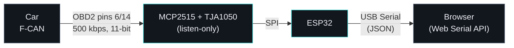

# OpenSource AutoDiag

> 🇪🇸 [Versión en español](README.md) (main README) · 🇬🇧 English version below.
>
> The web interface itself is in Spanish. Interface labels are quoted as they appear on screen, with an English gloss where needed.

<p>
  
  
  
  
  
  
</p>

A homemade, open-source diagnostic tool for a car's CAN bus: **car → ESP32 → USB → browser**. No apps, no cloud, no commercial scan tool required. It relies on Web Serial, so the interface is plain HTML that runs in desktop Chrome/Edge.

<p align="center">
  
</p>
<p align="center"><sub>Screenshots use sample data, with no car connected.</sub></p>

The goal is not just another engine scanner, but a **reusable platform** that eventually covers everything the car's gateway exposes — engine, ABS/VSA, SRS, BCM, instrument cluster — and that can serve as a base if it is configured for another vehicle in the future.

> **Current reference car:** Honda Civic 8th gen (FN2/FK3), 2.2 i-CTDi engine (N22A). The engine-specific diagnostics for that car (variable-geometry turbo, DPF, EGR, rail pressure) were developed separately, before the project was generalized, and are not part of this repository.

---

## Contents

- [Project phases](#project-phases)
- [Architecture](#architecture)
- [Repository layout](#repository-layout)
- [Hardware](#hardware)
- [Wiring](#wiring-mcp2515)
- [Build and upload](#build-and-upload-platformio)
- [Usage — Phase 1: passive sniffer](#usage--phase-1-passive-sniffer)
- [Usage — Phases 2-3: unified app](#usage--phases-2-3-unified-app-webapphtml)
- [Interface (UI/UX)](#interface-uiux)
- [Safety](#safety)
- [Adding a car to the garage](#adding-a-car-to-the-garage)
- [Next steps](#next-steps)

---

## Project phases

The plan advances in three phases. Each one depends on the previous one producing real results — there is no point building a fault-code interface on top of CAN IDs that have not been confirmed.

### Phase 1 — Passive reconnaissance ✅ in use

With no public ID table for any car, the first step is always to **listen** to the bus without touching anything, and correlate which ID changes with each real action (brake, indicator, window...).

- `firmware/sniffer/sniffer.cpp` + `web/sniffer.html`
- MCP2515 in **listen-only** mode at the silicon level: it cannot transmit anything, not even an ACK.
- It only sees the **F-CAN** (engine, transmission, ABS/VSA, probably SRS/BCM). The comfort B-CAN (windows, climate control) is not reachable with this hardware from the OBD2 port.
- It is kept as a minimal tool, untouched in firmware and logic — a safe first contact with any new car before moving to active mode. Visually it shares the same design tokens as `app.html` (colors, typography, transitions), but it remains a separate page with no garage.

<p align="center">
  
</p>

### Phase 2 — Identify the diagnostic IDs for each module 🚧 in development

DTCs and live data do not travel in broadcast frames — they use **request/response pairs** (such as the engine's `0x7DF`→`0x7E8`) that stay silent until something asks. The passive sniffer from Phase 1 will not find them just by operating things in the car.

- `firmware/autodiag/autodiag.cpp`, the **Descubrir IDs** (*Discover IDs*) tab of `web/app.html`.
- Explicit `MODE:ACTIVE` command to switch from listening to transmitting — until it is issued, everything stays listen-only.
- Sweep over a range of candidate IDs with `DiagnosticSessionControl` (`10 03`), recording which ECUs respond. Still **low risk**: only that session service, never writes.
- Not yet tested against a real car — pending the next session with the car at hand.

### Phase 3 — Unified web application with a multi-car garage 🚧 in development

Once each module's IDs are confirmed in Phase 2, the app stops being "one HTML page per firmware" (like `sniffer.html`) and becomes **a single application (`web/app.html`)** with a **garage**: it manages several cars at once, each with its own profile (modules, IDs, PIDs) — adding a new car is configuration, not code.

- Per-module DTC reading (services `03`/`19`), with a decoded view.
- DTC clearing (`04`/`14`) with explicit confirmation in the interface (type "BORRAR", Spanish for "DELETE").
- Per-module live data, with gauges and a chart (Chart.js).
- Custom interface: sidebar, dark theme with technical typography (Inter + JetBrains Mono), radial gauges for live data, and a validated color palette (series colors with colorblind-safe separation). Careful interaction details (press feedback, transitions with custom easing curves, staggered list entry) and support for `prefers-reduced-motion`.
- Still no server and no cloud: Web Serial + a single self-contained HTML file, like the rest of the project.

---

## Architecture



No server, no cloud: the ESP32 emits JSON over serial and the web page interprets it with the Web Serial API directly in the browser.

---

## Repository layout

```
firmware/       One .cpp per environment, each in its own folder
                   sniffer/sniffer.cpp    — Phase 1, listen-only, transmits nothing
                   autodiag/autodiag.cpp  — Phases 2-3, generic firmware (see Safety)
web/            Web interfaces (Web Serial)
                   sniffer.html — Phase 1 on its own
                   app.html     — unified app (Phases 2-3), with multi-car garage
tools/          Utilities (backup serial monitor in Python)
capturas/       CSVs exported from the interface (ignored by git)
platformio.ini  Build environments
```

Each firmware is a plain `.cpp` (no `.ino`, none of Arduino's auto-prototype/auto-include magic): `platformio.ini` sets `src_dir = firmware` and each environment uses `build_src_filter` to compile only its own subfolder. There is no prior copy step and no single-active-file limit — build whichever one you need directly:

```bash
pio run -e autodiag -t upload
```

---

## Development

`main` is the general platform (this README). Larger work is done on short-lived branches that are merged back into `main` once the change is considered good.

---

## Hardware

- ESP32 DevKit
- OBD2 breakout cable (CAN+, CAN−, K-line, +12 V)
- MCP2515 + TJA1050 module — gives access to the **F-CAN** (11-bit, 500 kbps)
- Dupont wires; for permanent use, a 12 V→5 V regulator if powered from the car

---

## Wiring (MCP2515)

```
OBD2 pin 6  (CAN-H) ──► MCP2515 CANH
OBD2 pin 14 (CAN-L) ──► MCP2515 CANL
OBD2 pin 4/5 (GND)  ──► common GND (ESP32 + module)

MCP2515 VCC ──► 5V (see 5V/3.3V warning)    MCP2515 GND ──► GND
MCP2515 SCK ──► ESP32 GPIO18                 MCP2515 SI  ──► ESP32 GPIO23 (MOSI)
MCP2515 SO  ──► ESP32 GPIO19 (MISO)*         MCP2515 CS  ──► ESP32 GPIO5
MCP2515 INT ──► ESP32 GPIO4
```

**⚠️ 5V/3.3V warning.** The module uses 5 V logic; its **SO (MISO)** output reaches the ESP32, which is a 3.3 V part, at 5 V. Pick one:
- Voltage divider on SO: 5 V → 3.3 V (e.g. 1 kΩ + 2 kΩ), **or**
- Bidirectional level shifter, **or**
- The "3.3 V mod": power the whole module at 3.3 V (often works for reading, although the CAN levels become somewhat marginal).

The module's inputs (SCK, SI, CS) accept the ESP32's 3.3 V just fine; only the return SO line needs protecting.

**Unused pins (K-line, permanent +12 V):** insulate each one individually with tape at its end, don't just bundle them — this stops them touching each other or GND/CAN under the dashboard. Pin 16 (+12 V) is usually fused in the car itself, so a short there will most likely blow a fuse rather than damage an ECU — but better not to find out.

**Crystal:** if the module doesn't start, change `MCP_8MHZ` to `MCP_16MHZ` (or vice versa) in the firmware you use. It is the #1 failure with these modules.

---

## Build and upload (PlatformIO)

You need [PlatformIO](https://platformio.org/) (VS Code extension, or `pip install platformio`). The libraries (`mcp_can`) download automatically the first time. If you don't want to clone the repo, download the `.zip` from the latest [Release](https://github.com/Antozjr/OpenSource-AutoDiag/releases), unzip it and run the same commands from that folder.

> The pins are fixed in the firmware (see [Wiring](#wiring-mcp2515)) and the project is configured for an `esp32dev` board.

1. `platformio.ini` provides one environment per firmware (`sniffer`, `autodiag`). Select it in PlatformIO's status bar or with `-e`.
2. **Build → Upload.** Adjust `board` in `platformio.ini` if your board is not `esp32dev`.
3. Open the matching HTML file in `web/` (`web/app.html` for normal use; `web/sniffer.html` if you only want the minimal passive mode) in **desktop Chrome or Edge** (Web Serial does not work in Firefox/Safari; on Android it works in Chrome, but check it on your specific device).

---

## Usage — Phase 1: passive sniffer

### Before touching the car
- ESP32 disconnected from everything while you check the wiring.
- Review: pin 6→CANH, pin 14→CANL, pin 4/5→GND, and unused pins insulated.
- If you have a multimeter, check continuity between what is insulated and what you do use.

### Connection
1. **Ignition off.** Connect the OBD2 adapter to the car with everything switched off.
2. Connect the ESP32 to the computer over USB.
3. Open `web/sniffer.html`, press **Conectar ESP32** (*Connect ESP32*) and choose the port.
4. Check the console: `{"evt":"ready","proto":"F-CAN 500k listen-only"}`.
5. With the ignition still off it is normal to see **"Sin tráfico CAN"** (*No CAN traffic*) — most modules are asleep.

### Ignition on (engine not started)
6. Turn the key to the ignition position.
7. The indicator should change to **"Tráfico CAN detectado"** (*CAN traffic detected*) within a few seconds. If not, disconnect and check the wiring before continuing.
8. Try the first markers: indicators, lights, windows.

### Engine running (optional)
9. Start the engine only if you want to capture additional engine traffic. It changes nothing in terms of safety — it is still listen-only.
10. With the car stationary, try the brake as a marker.

### When finished
11. Export the CSV (the first time it asks you to pick a folder — use `capturas/`, already in the repo and ignored by git; Chrome remembers it for next time). The CSV is a **timeline**, not a final snapshot: every frame that changed and every marker you set, in the order they actually happened (columns `timestamp,tipo,id,datos,nota` — *timestamp, type, id, data, note*) — so you can read it top to bottom and see which ID changed right after each marker. It is the format intended for sharing a capture so that someone (or Claude) can analyze it.
12. Turn the ignition off and **unplug the OBD2 connector** — don't leave it dangling, it can drain the battery.

---

## Usage — Phases 2-3: unified app (`web/app.html`)

Upload `firmware/autodiag/autodiag.cpp` (it starts in passive mode, like the sniffer) and open `web/app.html`. The header has a car selector (the garage) and the connection status; the tabs always operate on the **selected car**.

1. **Sniffer** — same as in Phase 1, but every discovered ID has a "Usar en módulo" (*Use in module*) button to register it directly on the active car.
2. **Descubrir IDs** (*Discover IDs*) — press **Activar modo transmisión** (*Enable transmit mode*; it starts transmitting, flagged in red), set a range (default `700`–`7FF`) and start the sweep. Every ID that responds can be added as a module with one click.
3. **Módulos / DTC** (*Modules / DTC*) — choose a module of the active car, read its DTCs, and clear them if needed (requires typing "BORRAR").
4. **Datos en vivo** (*Live data*) — choose a module and its PIDs, and start polling: gauges + live chart.
5. **Mi garaje** (*My garage*) — add, rename or delete cars; edit each car's JSON profile by hand; export/import a single car or the whole garage.

<p align="center">
  
  
</p>

As in Phase 1: always with the car stationary or idling, never looking at the screen while driving.

---

## Interface (UI/UX)

`web/app.html` and `web/sniffer.html` share one visual language, each self-contained in its own `<style>`/`<script>` (no build step, no shared modules — a project decision, not a shortcoming). If you are going to touch the interface, this is what already exists and why:

### Design system

- **Tokens in `:root`**: colors (`--bg`, `--panel`, `--accent`...), radii (`--r-sm/md/lg`), custom easing curves (`--ease-out: cubic-bezier(.23,1,.32,1)`, `--ease-in-out`) and shadows tinted dark blue instead of pure black (`--shadow-sm`, `--shadow-md`). Use the existing variables before inventing a new color or curve.
- **Typography**: Inter for dense interface text, JetBrains Mono for data/numbers (with `font-variant-numeric: tabular-nums` wherever figures change), and Space Grotesk (`--font-display`) only for the "AutoDiag" wordmark and the sniffer's `<h1>` — it gives presence without affecting the density of everything else.
- **Single-accent palette** (teal `#34d3d1`): don't add a second brand color. The series colors (`--s1`..`--s8`, for the live-data chart) are the only categorical palette and are already validated for color blindness — don't reorder or cycle them.
- **Interaction**: `:active{transform:scale(.97)}` on buttons, `:focus-visible` with a focus ring, 120-250 ms transitions using the `--ease-out` curves, staggered entry (`animation-delay` per `nth-child`) on lists that appear all at once (gauges, DTCs), and everything respects `prefers-reduced-motion` (see the `@media` block at the top of each `<style>`).

### Dialogs and notifications — never `alert()`/`prompt()`/`confirm()`

`web/app.html` defines its own system that replaces the browser's native dialogs (which block the tab and cannot be styled):

- `toast(message, type)` — non-blocking notification; `type` is `'ok'`, `'error'` or empty. It also exists in `sniffer.html` (an identical copy, the only function duplicated between the two files).
- `askText(message, defaultValue)` — `Promise<string|null>`, replaces `prompt()`.
- `askConfirm(message)` — `Promise<boolean>`, replaces `confirm()`.
- All three build on `showModal(bodyHtml, wire)`, the shared helper that mounts the overlay, the enter/exit animation and closing via Escape/outside click. If you need a fourth kind of dialog, add another function that calls `showModal()` — don't duplicate the overlay mechanics.

If you see an `alert(`, `prompt(` or `confirm(` in `web/*.html`, it is a regression — report it or fix it.

### Feels native on mobile

The project's real-world deployment is an Android phone (see [Serve the app from a phone](#serve-the-app-from-a-phone-optional) below), so these details are not cosmetic:

| What | Why | Don't remove |
|---|---|---|
| `viewport-fit=cover` in the `<meta viewport>` | Without it, `env(safe-area-inset-bottom)` is always `0px` — the safe-area padding of the mobile bottom bar silently stops working | ✅ |
| `100dvh` instead of `100vh` on `.shell`/`.sidebar` | `100vh` is measured with Chrome's URL bar collapsed; the layout jumps when it appears/hides | ✅ |
| `:hover` only under `@media (hover:hover) and (pointer:fine)` | Without it, tapping a button leaves the hover state stuck until you tap something else | ✅ |
| `-webkit-tap-highlight-color: transparent` on `html` | Removes the grey/blue flash on tap | ✅ |
| `font-size:16px` on inputs, only under `@media (pointer:coarse)` | Avoids the touch keyboard's automatic zoom, without bloating density on desktop | ✅ |
| `overscroll-behavior:none` on `html,body`, `:contain` on `.tablewrap`/`.log` | Android's pull-to-refresh must not hijack the scroll of an inner table | ✅ |
| `touch-action:manipulation` + `user-select:none` on buttons (not on `code`/table cells — those stay copyable) | Faster taps, no accidental selection of a button's text | ✅ |

### How to test interface changes

There is no automated test — verification is done in a real browser:

```bash
cd web && python3 -m http.server 8791
```

Then open `http://localhost:8791/app.html` (or `sniffer.html`) in desktop Chrome or Edge. To check the mobile layout, use the DevTools device mode (F12 → phone icon).

To stop the test server: `pkill -f "http.server 8791"`.

---

## Safety

- **Phase 1 (`sniffer.cpp`):** no transmit call (`CAN.sendMsgBuf`) anywhere in the file, MCP2515 in listen-only — it cannot interfere with the bus whatever happens in the code.
- **Phases 2-3 (`autodiag.cpp`):** it also starts in listen-only; transmitting requires the explicit `MODE:ACTIVE` command. Two independent barriers limit what can be sent:
  1. In `web/app.html`, the `sendUds()` function rejects any SID that is not in the allow-list (`01 03 09 10 14 19 22 3E 04`) before sending anything to the firmware, and requires typing "BORRAR" for the clearing services (`04`/`14`).
  2. The firmware itself repeats that same check, just in case — a bug in the web page is not enough to bypass it.
  - No data-write service (`0x2E`) or routine-control service (`0x31`) is allowed on any layer. Don't add SIDs to that list without thinking twice.
- **Electrical level:** the real wiring risk does not change between phases — see the unused-pins warning above.
- Don't look at the screen while driving — record and analyze with the car stationary, or have someone else drive.

---

## Adding a car to the garage

`web/app.html` manages a **garage**: a list of cars, each with its own profile (modules, IDs, PIDs), stored in the browser's `localStorage` and exportable/importable as JSON. Adding a new car — of any make and model — is **configuration, not code**: nothing Honda-specific, or specific to this Civic, is hardcoded in `firmware/autodiag/autodiag.cpp` or in the app engine.

**Reusable as-is (the platform):**
- `firmware/autodiag/autodiag.cpp` and `firmware/sniffer/sniffer.cpp` — generic, they know nothing about any particular car.
- `web/app.html` — the garage, the tabs and the UDS/ISO-TP logic do not depend on any specific car.
- The phased methodology in this README, and the MCP2515 wiring (the OBD2 CAN-H/CAN-L/GND pins are standard).

**Specific to each car (lives in its garage profile, not in the code):**
```json
{
  "id": "mi-coche",
  "name": "Make Model Year",
  "bus": "can",
  "modules": [
    {
      "id": "engine", "label": "Motor (ECM)",
      "reqId": "7E0", "respId": "7E8",
      "dtcService": "03", "clearService": "04",
      "pids": [{"label":"RPM","mode":"01","pid":"0C","formula":"(A*256+B)/4","unit":""}]
    }
  ]
}
```
- `bus`: `"can"` or `"kline"` — which physical protocol this car speaks on the OBD2 connector (see below, not all of them use CAN).
- `reqId`/`respId`: request/response CAN IDs of that module (engine, ABS, SRS...) — discovered with the Sniffer and Descubrir IDs tabs.
- `dtcService`/`clearService`: `"03"`/`"04"` for generic OBD2, `"19"`/`"14"` for manufacturer-specific UDS.
- `pids`: list of live-data items, with their decoding formula (a simple JS expression using the response bytes as `A`,`B`,`C`,`D`).

**Mi garaje** tab → *Añadir coche* (*Add car*) → edit its JSON by hand with whatever you discover. The Civic N22A comes preloaded as an example, with the known PIDs ported from the original VGT diagnostics.

The original VGT diagnostics for this Civic (engine, variable-geometry turbo, DPF, EGR) were developed separately and are not part of this platform's garage.

### CAN or K-line — not every car speaks the same thing

Not every car in the garage uses CAN. Older cars (roughly before 2004, depending on make and on petrol vs diesel — EOBD was not mandatory on diesels in the EU until 2003/2004) usually use **K-line** (ISO9141-2/KWP2000) on the OBD2 connector, with pins 6/14 (CAN) simply not wired. It is different hardware: CAN needs the MCP2515 module the project already uses; K-line needs a separate transceiver.

**What to buy for K-line.** The classic chip for these projects, the L9637D, is **discontinued** — which is why it can't be found as a loose module on AliExpress, only old stock of the bare chip. The real, verified option: **[ISO 9141 Click](https://www.mikroe.com/iso-9141-click)** (MikroElektronika, ~€7, also at [SparkFun](https://www.sparkfun.com/mikroe-iso-9141-click-dev-20576.html)) — it carries the same L9637 chip but already mounted on a board with `K`, `L`, `TX`, `RX`, `VCC` (3.3V/5V jumper) and `GND` pins silk-screened. Wiring:
```
OBD2 pin 7 (K-line) ──► Click K
Click VCC ──► ESP32 3.3V (board jumper on 3.3V)
Click GND ──► common GND
Click TX  ──► ESP32 GPIO16 (RX2)
Click RX  ──► ESP32 GPIO17 (TX2)
```
Unlike CAN, there is no 5V/3.3V level mess here — the board already handles it. The CAN and K-line pins don't clash, so both modules can be mounted on the same ESP32 at once without conflict (for when automatic detection exists).

**Plan (documented here, firmware not yet built):** when K-line is needed for some car in the garage, the goal is for the ESP32 to **detect it automatically** at startup — listening on both transceivers (if both are physically fitted) and settling on the one that sees real traffic, with no need for the user to pick by hand or switch firmware. Until it is implemented, `firmware/autodiag/autodiag.cpp` remains CAN-only; the K-line code from that original diagnostics work was a completely separate firmware. It will be built when some car in the garage really needs it, not before — to avoid adding code that is useless until then.

**Cars researched so far:**

| Car | Bus | Source |
|---|---|---|
| Honda Civic 2.2 i-CTDi (N22A), 2006-2011 | CAN 500k | Project's initial research |
| Citroën C3, 8HX engine (1.4 HDi), 2002 | **K-line** (KWP2000/ISO14230, fast-init) | Researched — this C3 predates PSA's "Full CAN" architecture (~2004); OBD2 pins 6/14 aren't even wired |
| Opel Astra G, Y20DTH engine ("2.0 DTI", not "CDTI" — that name arrives with the 2003 1.7 CDTI), 2002 | **K-line** (ISO9141-2/KWP2000) | Researched — the Astra G (1998-2004) has no CAN; that arrives with the Astra H (2004+). Exact frame parameters (ECU address, key bytes) unconfirmed, pending verification with the real car |
| Renault Captur, K9K engine (1.5 dCi), 2014 | **CAN** 500k | Researched — engine (`0x7E0`→`0x7E8`) via standard EOBD, high confidence. No Secure Gateway in this generation (it arrives with Captur II/Clio V), so OBD2 also reaches UCH/ABS/airbag/EPS. The specific UDS IDs of those modules are not public — to be discovered with `SWEEP`, as with the Civic. DTC format: Renault uses internal "DF" codes (via CAN Clip) that don't map 1:1 to Pxxxx — reading via `0x19`/standard mode 03 should yield the generic P-code equivalent |

---

## Next steps

- [ ] Passive sniffer session on the real car (Phase 1) — still to do
- [x] Generic firmware + diagnostic ID sweep (Phase 2) — built, not yet tested against a real car
- [x] Unified app with garage, DTC read/clear and live data (Phase 3) — built, pending testing and tuning with real data
- [ ] Validate the active sweep (`MODE:ACTIVE` + `SWEEP`) against the real car
- [ ] Check the 3-byte DTC decoding (UDS `0x19`) against real data — it is an approximation, see the note in the interface itself

> Side note: the app (`web/`) can be hosted as static files anywhere if you don't want to open it locally — it is a personal choice, not something the project needs in order to work.

---

## Install as an app (PWA)

`web/` includes `manifest.json` + `service-worker.js`, so it can be installed as a real app (its own icon, no address bar, instant loading) instead of opening as a loose browser tab. It works when served from anywhere over http(s) — open the URL in Chrome and use **Install app** / **Add to home screen**.

### Serve the app from a phone (optional)

This is pure hosting: it doesn't change how the ESP32 connects (it's still USB + Web Serial, local to each device). It only serves to have the app at a fixed URL instead of launching a local server each time.

1. On the phone (e.g. Android with Termux), clone the repo and start a static server: `cd OpenSource-AutoDiag/web && python -m http.server 8080`.
2. Open `http://<phone-ip>:8080/app.html` from another device on the same network (or on your VPN, e.g. Tailscale).
3. **Web Serial needs HTTPS** (or `localhost`). On a plain `http://` URL the interface loads, but the "Conectar ESP32" (*Connect ESP32*) button doesn't work. Options: serve over HTTPS, or, only on your own laptop, enable `chrome://flags/#unsafely-treat-insecure-origin-as-secure` and add that URL there.
4. With Termux, use `termux-wake-lock` so Android doesn't kill the server when you minimize the app, and if `pkg install` fails try forcing IPv4 in apt (`Acquire::ForceIPv4 "true";`).
