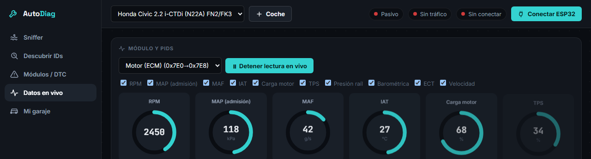
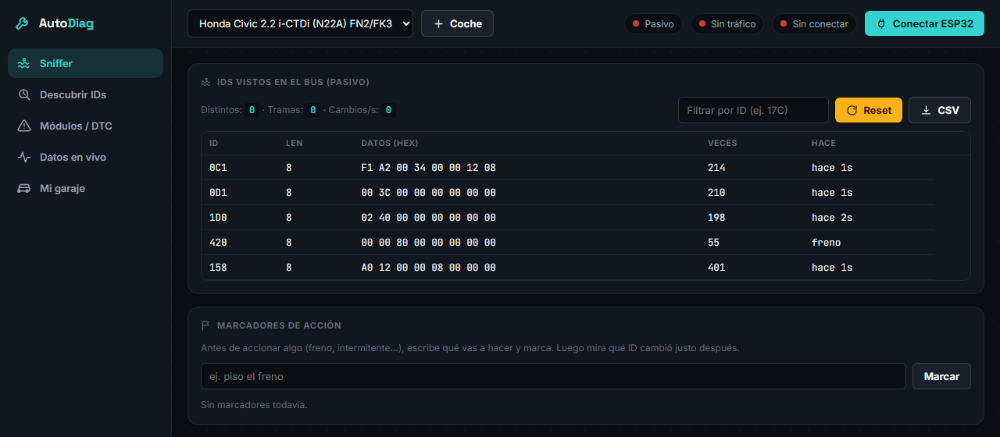
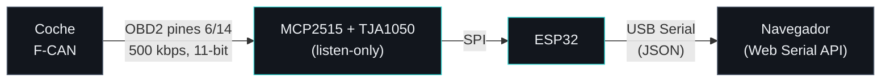
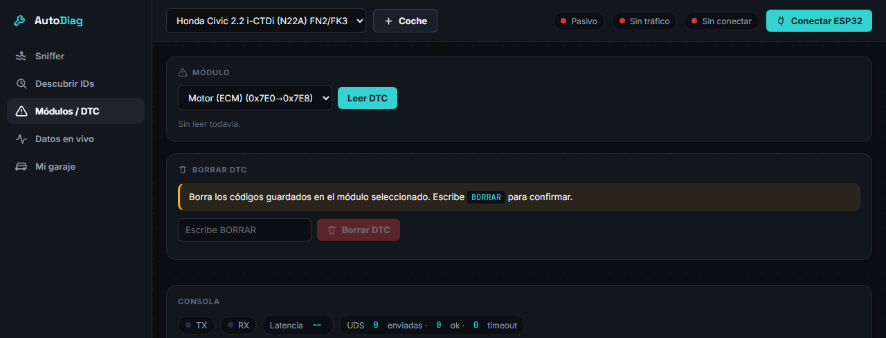
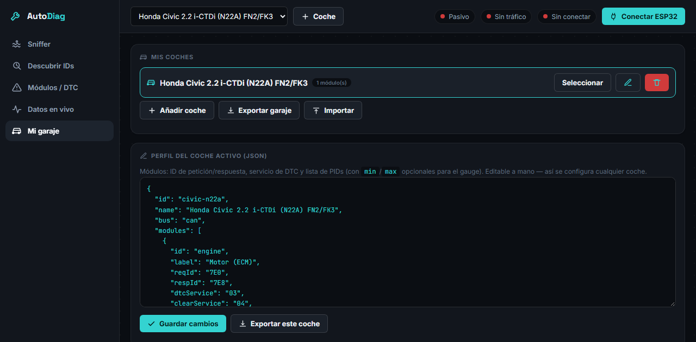

# OpenSource AutoDiag

<p>
  
  
  
  
  
  
</p>

Herramienta de diagnóstico casera y de código abierto para el bus CAN de un coche: **coche → ESP32 → USB → navegador**, sin apps, sin nube, sin depender de un escáner comercial. Se apoya en Web Serial, así que la interfaz es HTML plano que corre en Chrome/Edge de escritorio.

<p align="center">
  
</p>
<p align="center"><sub>Capturas con datos de ejemplo, sin coche conectado.</sub></p>

El objetivo no es un escáner de motor más, sino una **plataforma reutilizable** que llegue a cubrir todo lo que permite la Gateway del coche — motor, ABS/VSA, SRS, BCM, cuadro — y que sirva de base si en el futuro se configura para otro vehículo.

> **Coche de referencia actual:** Honda Civic 8ª gen (FN2/FK3), motor 2.2 i-CTDi (N22A). El diagnóstico específico de ese motor (turbo de geometría variable, DPF, EGR, presión de raíl) se desarrolló aparte, antes de generalizar el proyecto, y no forma parte de este repositorio.

---

## Índice

- [Fases del proyecto](#fases-del-proyecto)
- [Arquitectura](#arquitectura)
- [Estructura del repo](#estructura-del-repo)
- [Hardware](#hardware)
- [Cableado](#cableado-mcp2515)
- [Compilar y subir](#compilar-y-subir-platformio)
- [Uso — Fase 1: sniffer pasivo](#uso--fase-1-sniffer-pasivo)
- [Uso — Fases 2-3: app unificada](#uso--fases-2-3-app-unificada-webapphtml)
- [Interfaz (UI/UX)](#interfaz-uiux)
- [Seguridad](#seguridad)
- [Añadir un coche al garaje](#añadir-un-coche-al-garaje)
- [Próximos pasos](#próximos-pasos)

---

## Fases del proyecto

El plan avanza en tres fases. Cada una depende de que la anterior dé resultados reales — no tiene sentido construir la interfaz de fallos sobre IDs de CAN que no se han confirmado.

### Fase 1 — Reconocimiento pasivo ✅ en uso

Sin tabla pública de IDs para ningún coche, el primer paso siempre es **escuchar** el bus sin tocar nada, e ir correlacionando qué ID cambia con cada acción real (freno, intermitente, ventanilla...).

- `firmware/sniffer/sniffer.cpp` + `web/sniffer.html`
- MCP2515 en modo **listen-only** a nivel de silicio: no puede transmitir nada, ni siquiera un ACK.
- Solo ve el **F-CAN** (motor, transmisión, ABS/VSA, probablemente SRS/BCM). El B-CAN de confort (elevalunas, climatizador) no es alcanzable con este hardware desde el OBD2.
- Se mantiene como herramienta mínima e intacta a nivel de firmware y lógica — primer contacto seguro con cualquier coche nuevo antes de pasar a modo activo. Visualmente comparte los mismos tokens de diseño que `app.html` (colores, tipografía, transiciones), pero sigue siendo una página independiente y sin garaje.

<p align="center">
  
</p>

### Fase 2 — Identificar los IDs de diagnóstico por módulo 🚧 en desarrollo

Los DTC y los datos en tiempo real no van por tramas de difusión — van por **pares petición/respuesta** (como `0x7DF`→`0x7E8` del motor) que están en silencio hasta que algo pregunta. El sniffer pasivo de la Fase 1 no los va a encontrar solo con accionar cosas del coche.

- `firmware/autodiag/autodiag.cpp`, pestaña **Descubrir IDs** de `web/app.html`.
- Comando explícito `MODE:ACTIVE` para pasar de escuchar a transmitir — hasta que no se pide, todo sigue en listen-only.
- Barrido de un rango de IDs candidatos con `DiagnosticSessionControl` (`10 03`) y registro de qué ECUs responden. Todavía de **bajo riesgo**: solo ese servicio de sesión, nunca escritura.
- Aún sin probar contra un coche real — pendiente de la próxima sesión con el coche a mano.

### Fase 3 — Aplicación web unificada, con garaje multi-coche 🚧 en desarrollo

Con los IDs de cada módulo confirmados en la Fase 2, la app deja de ser "una página HTML por firmware" (como `sniffer.html`) y pasa a ser **una sola aplicación (`web/app.html`)** con un **garaje**: gestiona varios coches a la vez, cada uno con su propio perfil (módulos, IDs, PIDs) — añadir un coche nuevo es configuración, no código.

- Lectura de DTC por módulo (servicios `03`/`19`), con vista decodificada.
- Borrado de DTC (`04`/`14`) con confirmación explícita en la interfaz (escribir "BORRAR").
- Datos en tiempo real por módulo, con gauges y gráfica (Chart.js).
- Interfaz propia: barra lateral, tema oscuro con tipografía técnica (Inter + JetBrains Mono), gauges radiales para los datos en vivo, y una paleta de color validada (colores de serie con separación segura para daltonismo). Detalles de interacción cuidados (feedback al pulsar, transiciones con curvas de easing propias, entrada escalonada de listas) y respeto de `prefers-reduced-motion`.
- Sigue sin servidor ni nube: Web Serial + un único HTML autocontenido, igual que el resto del proyecto.

---

## Arquitectura



Sin servidor, sin nube: el ESP32 emite JSON por serie y la página web lo interpreta con la Web Serial API directamente en el navegador.

---

## Estructura del repo

```
firmware/       Un .cpp por entorno, cada uno en su propia carpeta
                   sniffer/sniffer.cpp    — Fase 1, listen-only, no transmite nada
                   autodiag/autodiag.cpp  — Fases 2-3, firmware genérico (ver Seguridad)
web/            Interfaces web (Web Serial)
                   sniffer.html — Fase 1 en solitario
                   app.html     — app unificada (Fases 2-3), con garaje multi-coche
tools/          Utilidades (monitor serie de respaldo en Python)
capturas/       CSV exportados desde la interfaz (ignorados por git)
platformio.ini  Entornos de compilación
```

Cada firmware es un `.cpp` plano (sin `.ino`, sin la magia de auto-prototipos/auto-include de Arduino): `platformio.ini` fija `src_dir = firmware` y cada entorno usa `build_src_filter` para compilar solo su propia subcarpeta. No hay copia previa ni límite de un solo archivo activo — compila el que toque directamente:

```bash
pio run -e autodiag -t upload
```

---

## Desarrollo

`main` es la plataforma general (este README). El trabajo grande se hace en ramas de corta duración que se fusionan de vuelta a `main` cuando el cambio se da por bueno.

---

## Hardware

- ESP32 DevKit
- Cable de breakout OBD2 (CAN+, CAN−, K-line, +12 V)
- Módulo MCP2515 + TJA1050 — da acceso al **F-CAN** (11-bit, 500 kbps)
- Cables dupont; para uso permanente, un regulador 12 V→5 V si se alimenta desde el coche

---

## Cableado (MCP2515)

```
OBD2 pin 6  (CAN-H) ──► MCP2515 CANH
OBD2 pin 14 (CAN-L) ──► MCP2515 CANL
OBD2 pin 4/5 (GND)  ──► GND común (ESP32 + módulo)

MCP2515 VCC ──► 5V (ver aviso 5V/3.3V)      MCP2515 GND ──► GND
MCP2515 SCK ──► ESP32 GPIO18                 MCP2515 SI  ──► ESP32 GPIO23 (MOSI)
MCP2515 SO  ──► ESP32 GPIO19 (MISO)*         MCP2515 CS  ──► ESP32 GPIO5
MCP2515 INT ──► ESP32 GPIO4
```

**⚠️ Aviso 5V/3.3V.** El módulo es de lógica 5 V; su salida **SO (MISO)** llega a 5 V al ESP32, que es de 3.3 V. Elige una:
- Divisor de tensión en SO: 5 V → 3.3 V (p.ej. 1 kΩ + 2 kΩ), **o**
- Adaptador de nivel bidireccional, **o**
- El "mod de 3.3 V": alimentar el módulo entero a 3.3 V (funciona a menudo para leer, aunque los niveles CAN quedan algo justos).

Las entradas del módulo (SCK, SI, CS) aceptan bien los 3.3 V del ESP32; solo hay que proteger la línea SO de vuelta.

**Pines que no se usan (K-line, +12 V permanente):** aíslalos individualmente con cinta en sus extremos, no solo los agrupes — evita que se toquen entre sí o con GND/CAN bajo el salpicadero. El pin 16 (+12 V) suele estar fusionado en el propio coche, así que un cortocircuito ahí lo más probable es que funda un fusible, no que dañe una ECU — pero mejor no comprobarlo.

**Cristal:** si el módulo no arranca, en el firmware que uses cambia `MCP_8MHZ` por `MCP_16MHZ` (o al revés). Es el fallo nº1 con estos módulos.

---

## Compilar y subir (PlatformIO)

1. `platformio.ini` trae un entorno por firmware (`sniffer`, `autodiag`). Selecciónalo en la barra de estado de PlatformIO o con `-e`.
2. **Build → Upload.** Ajusta `board` en `platformio.ini` si tu placa no es `esp32dev`.
3. Abre el HTML correspondiente en `web/` (`web/app.html` para el uso normal; `web/sniffer.html` si solo quieres el modo mínimo pasivo) en **Chrome o Edge de escritorio** (Web Serial no va en Firefox/Safari; en Android funciona en Chrome, pero conviene comprobarlo en el dispositivo concreto).

---

## Uso — Fase 1: sniffer pasivo

### Antes de tocar el coche
- ESP32 desconectado de todo mientras revisas el cableado.
- Repasa: pin 6→CANH, pin 14→CANL, pin 4/5→GND, y pines sin usar tapados.
- Si tienes multímetro, comprueba continuidad entre lo tapado y lo que sí usas.

### Conexión
1. **Contacto quitado.** Conecta el OBD2 al coche con todo apagado.
2. Conecta el ESP32 al ordenador por USB.
3. Abre `web/sniffer.html`, pulsa **Conectar ESP32** y elige el puerto.
4. Verifica en consola: `{"evt":"ready","proto":"F-CAN 500k listen-only"}`.
5. Con el contacto aún quitado es normal ver **"Sin tráfico CAN"** — la mayoría de módulos están dormidos.

### Contacto puesto (sin arrancar)
6. Gira la llave a contacto.
7. El indicador debería pasar a **"Tráfico CAN detectado"** en pocos segundos. Si no, desconecta y revisa el cableado antes de seguir.
8. Prueba los primeros marcadores: intermitentes, luces, elevalunas.

### Motor en marcha (opcional)
9. Arranca solo si quieres capturar tráfico adicional de motor. No cambia nada a nivel de seguridad — sigue siendo listen-only.
10. Con el coche parado, prueba el freno como marcador.

### Al terminar
11. Exporta el CSV (la primera vez te pedirá elegir carpeta — usa `capturas/`, ya en el repo e ignorada por git; Chrome la recuerda para la próxima vez). El CSV es una **línea temporal**, no una foto final: cada trama que cambió y cada marcador que pusiste, en el orden real en que ocurrieron (columnas `timestamp,tipo,id,datos,nota`) — así se puede leer de arriba a abajo y ver qué ID cambió justo después de cada marcador. Es el formato pensado para compartir la captura y que alguien (o Claude) la analice.
12. Quita el contacto y **desconecta el conector OBD2** — no lo dejes colgando, puede descargar la batería.

---

## Uso — Fases 2-3: app unificada (`web/app.html`)

Sube `firmware/autodiag/autodiag.cpp` (arranca en pasivo, igual que el sniffer) y abre `web/app.html`. La cabecera tiene un selector de coche (el garaje) y el estado de conexión; las pestañas operan siempre sobre el **coche seleccionado**.

1. **Sniffer** — igual que en Fase 1, pero cada ID descubierto tiene un botón "Usar en módulo" para darlo de alta directamente en el coche activo.
2. **Descubrir IDs** — pulsa **Activar modo transmisión** (empieza a transmitir, avisado en rojo), define un rango (por defecto `700`–`7FF`) y lanza el barrido. Cada ID que responda se puede añadir como módulo con un clic.
3. **Módulos / DTC** — elige un módulo del coche activo, lee sus DTC, y bórralos si hace falta (requiere escribir "BORRAR").
4. **Datos en vivo** — elige un módulo y sus PIDs, y arranca el polling: gauges + gráfica en vivo.
5. **Mi garaje** — añade, renombra o elimina coches; edita el perfil JSON de cada uno a mano; exporta/importa un coche o el garaje completo.

<p align="center">
  
  
</p>

Igual que en Fase 1: siempre con el coche parado o a ralentí, nunca mirando la pantalla mientras se conduce.

---

## Interfaz (UI/UX)

`web/app.html` y `web/sniffer.html` comparten un mismo lenguaje visual, cada uno autocontenido en su propio `<style>`/`<script>` (sin build step, sin módulos compartidos — es una decisión del proyecto, no una carencia). Si vas a tocar la interfaz, esto es lo que ya existe y por qué:

### Sistema de diseño

- **Tokens en `:root`**: colores (`--bg`, `--panel`, `--accent`...), radios (`--r-sm/md/lg`), curvas de easing propias (`--ease-out: cubic-bezier(.23,1,.32,1)`, `--ease-in-out`) y sombras con tinte azul-oscuro en vez de negro puro (`--shadow-sm`, `--shadow-md`). Usa las variables existentes antes de inventar un color o una curva nueva.
- **Tipografía**: Inter para texto de interfaz denso, JetBrains Mono para datos/números (con `font-variant-numeric: tabular-nums` donde hay cifras que cambian), y Space Grotesk (`--font-display`) solo para el wordmark "AutoDiag" y el `<h1>` del sniffer — le da presencia sin tocar la densidad del resto.
- **Paleta de un solo acento** (teal `#34d3d1`): no añadas un segundo color de marca. Los colores de serie (`--s1`..`--s8`, para la gráfica de datos en vivo) son la única paleta categórica y ya están validados para daltonismo — no los reordenes ni los cicles.
- **Interacción**: `:active{transform:scale(.97)}` en botones, `:focus-visible` con anillo de foco, transiciones de 120-250ms con las curvas de `--ease-out`, entrada escalonada (`animation-delay` por `nth-child`) en listas que aparecen de golpe (gauges, DTC), y todo respeta `prefers-reduced-motion` (ver el bloque `@media` al principio de cada `<style>`).

### Diálogos y notificaciones — nunca `alert()`/`prompt()`/`confirm()`

`web/app.html` define un sistema propio que sustituye a los diálogos nativos del navegador (bloquean la pestaña y no se pueden estilizar):

- `toast(mensaje, tipo)` — notificación no bloqueante, `tipo` es `'ok'`, `'error'` o vacío. Existe también en `sniffer.html` (copia idéntica, es la única función que se duplica entre los dos archivos).
- `askText(mensaje, valorPorDefecto)` — `Promise<string|null>`, sustituye a `prompt()`.
- `askConfirm(mensaje)` — `Promise<boolean>`, sustituye a `confirm()`.
- Las tres construyen sobre `showModal(bodyHtml, wire)`, el helper compartido que monta el overlay, la animación de entrada/salida y el cierre por Escape/clic fuera. Si necesitas un cuarto tipo de diálogo, añade otra función que llame a `showModal()` — no dupliques la mecánica del overlay.

Si ves un `alert(`, `prompt(` o `confirm(` en `web/*.html`, es una regresión — repórtalo o arréglalo.

### Se siente nativa en el móvil

El despliegue real de este proyecto es un teléfono Android (ver [Servir la app desde un móvil](#servir-la-app-desde-un-móvil-opcional) más abajo), así que estos detalles no son cosméticos:

| Qué | Por qué | No lo quites |
|---|---|---|
| `viewport-fit=cover` en el `<meta viewport>` | Sin esto, `env(safe-area-inset-bottom)` vale siempre `0px` — el padding de zona segura de la barra inferior móvil deja de funcionar en silencio | ✅ |
| `100dvh` en vez de `100vh` en `.shell`/`.sidebar` | `100vh` mide con la barra de URL de Chrome colapsada; salta el layout al aparecer/ocultarse | ✅ |
| `:hover` solo bajo `@media (hover:hover) and (pointer:fine)` | Sin esto, tocar un botón deja el estado hover pegado hasta tocar otra cosa | ✅ |
| `-webkit-tap-highlight-color: transparent` en `html` | Quita el flash gris/azul al tocar | ✅ |
| `font-size:16px` en inputs, solo bajo `@media (pointer:coarse)` | Evita el zoom automático del teclado táctil, sin engordar la densidad en escritorio | ✅ |
| `overscroll-behavior:none` en `html,body`, `:contain` en `.tablewrap`/`.log` | El pull-to-refresh de Android no debe secuestrar el scroll de una tabla interna | ✅ |
| `touch-action:manipulation` + `user-select:none` en botones (no en `code`/celdas de tabla — esas siguen siendo copiables) | Toques más rápidos, sin selección accidental del texto de un botón | ✅ |

### Cómo probar cambios de interfaz

No hay test automatizado — se verifica en un navegador real:

```bash
cd web && python3 -m http.server 8791
```

Luego abre `http://localhost:8791/app.html` (o `sniffer.html`) en Chrome o Edge de escritorio. Para comprobar el diseño móvil, usa el modo dispositivo de las DevTools (F12 → icono de móvil).

Para parar el servidor de pruebas: `pkill -f "http.server 8791"`.

---

## Seguridad

- **Fase 1 (`sniffer.cpp`):** ninguna llamada de transmisión (`CAN.sendMsgBuf`) en todo el archivo, MCP2515 en listen-only — no puede interferir con el bus pase lo que pase en el código.
- **Fases 2-3 (`autodiag.cpp`):** arranca también en listen-only; transmitir requiere el comando explícito `MODE:ACTIVE`. Dos barreras independientes limitan qué se puede enviar:
  1. En `web/app.html`, la función `sendUds()` rechaza cualquier SID que no esté en la lista permitida (`01 03 09 10 14 19 22 3E 04`) antes de mandar nada al firmware, y exige escribir "BORRAR" para los servicios de borrado (`04`/`14`).
  2. El propio firmware repite esa misma comprobación por si acaso — un fallo en la web no basta para saltársela.
  - Ningún servicio de escritura de datos (`0x2E`) ni de rutina (`0x31`) está permitido en ninguna capa. No añadas SIDs a esa lista sin pensarlo dos veces.
- **A nivel eléctrico:** el riesgo real del cableado no cambia entre fases — ver el aviso de pines sin usar más arriba.
- No mires la pantalla conduciendo — registra y analiza con el coche parado, o que conduzca otra persona.

---

## Añadir un coche al garaje

`web/app.html` gestiona un **garaje**: una lista de coches, cada uno con su propio perfil (módulos, IDs, PIDs), guardada en `localStorage` del navegador y exportable/importable como JSON. Añadir un coche nuevo — de cualquier marca y modelo — es **configuración, no código**: no hay nada de Honda ni de este Civic hardcodeado en `firmware/autodiag/autodiag.cpp` ni en el motor de la app.

**Reutilizable tal cual (la plataforma):**
- `firmware/autodiag/autodiag.cpp` y `firmware/sniffer/sniffer.cpp` — genéricos, no saben nada de ningún coche.
- `web/app.html` — el garaje, las pestañas y la lógica de UDS/ISO-TP no dependen de ningún coche concreto.
- La metodología por fases de este README, y el cableado del MCP2515 (los pines OBD2 de CAN-H/CAN-L/GND son estándar).

**Específico de cada coche (vive en su perfil del garaje, no en el código):**
```json
{
  "id": "mi-coche",
  "name": "Marca Modelo Año",
  "bus": "can",
  "modules": [
    {
      "id": "engine", "label": "Motor (ECM)",
      "reqId": "7E0", "respId": "7E8",
      "dtcService": "03", "clearService": "04",
      "pids": [{"label":"RPM","mode":"01","pid":"0C","formula":"(A*256+B)/4","unit":""}]
    }
  ]
}
```
- `bus`: `"can"` o `"kline"` — qué protocolo físico habla este coche por el conector OBD2 (ver más abajo, no todos usan CAN).
- `reqId`/`respId`: IDs CAN de petición/respuesta de ese módulo (motor, ABS, SRS...) — se descubren con las pestañas Sniffer y Descubrir IDs.
- `dtcService`/`clearService`: `"03"`/`"04"` para OBD2 genérico, `"19"`/`"14"` para UDS manufacturer-specific.
- `pids`: lista de datos en vivo, con su fórmula de decodificación (expresión JS simple usando los bytes de respuesta como `A`,`B`,`C`,`D`).

Pestaña **Mi garaje** → *Añadir coche* → editar su JSON a mano con lo que se vaya descubriendo. El Civic N22A ya está cargado de serie como ejemplo, con los PIDs conocidos portados del diagnóstico VGT original.

El diagnóstico VGT original de este Civic (motor, turbo de geometría variable, DPF, EGR) se desarrolló aparte y no forma parte del garaje de esta plataforma.

### CAN o K-line — no todos los coches hablan lo mismo

No todos los coches del garaje usan CAN. Coches más antiguos (más o menos anteriores a 2004, según marca y si es gasolina o diésel — la EOBD no fue obligatoria en diésel en la UE hasta 2003/2004) suelen usar **K-line** (ISO9141-2/KWP2000) en el conector OBD2, con los pines 6/14 (CAN) directamente sin cablear. Es hardware distinto: CAN necesita el módulo MCP2515 que ya usa el proyecto; K-line necesita un transceptor aparte.

**Qué comprar para K-line.** El chip clásico de estos proyectos, el L9637D, está **descatalogado** — por eso no se encuentra como módulo suelto en AliExpress, solo stock antiguo del chip pelado. La opción real y verificada: **[ISO 9141 Click](https://www.mikroe.com/iso-9141-click)** (MikroElektronika, ~7€, también en [SparkFun](https://www.sparkfun.com/mikroe-iso-9141-click-dev-20576.html)) — lleva el mismo chip L9637 pero ya montado en una placa con pines `K`, `L`, `TX`, `RX`, `VCC` (jumper 3.3V/5V) y `GND` serigrafiados. Cableado:
```
OBD2 pin 7 (K-line) ──► Click K
Click VCC ──► 3.3V del ESP32 (jumper de la placa en 3.3V)
Click GND ──► GND común
Click TX  ──► ESP32 GPIO16 (RX2)
Click RX  ──► ESP32 GPIO17 (TX2)
```
A diferencia del CAN, aquí no hay lío de niveles 5V/3.3V — la placa ya lo resuelve. Los pines de CAN y K-line no se pisan, así que se pueden montar los dos módulos a la vez en el mismo ESP32 sin conflicto (para cuando exista la detección automática).

**Plan (documentado aquí, firmware aún no construido):** cuando haga falta K-line para algún coche del garaje, el objetivo es que el ESP32 lo **detecte automáticamente** al arrancar — escuchando en ambos transceptores (si están los dos físicamente montados) y quedándose con el que vea tráfico real, sin que el usuario tenga que elegir a mano ni cambiar de firmware. Hasta que se implemente, `firmware/autodiag/autodiag.cpp` sigue siendo solo-CAN; el K-line de aquel diagnóstico original era un firmware totalmente aparte. Se construirá cuando algún coche del garaje lo necesite de verdad, no antes — para no meter código que no sirve para nada hasta entonces.

**Coches investigados hasta ahora:**

| Coche | Bus | Fuente |
|---|---|---|
| Honda Civic 2.2 i-CTDi (N22A), 2006-2011 | CAN 500k | Investigación inicial del proyecto |
| Citroën C3, motor 8HX (1.4 HDi), 2002 | **K-line** (KWP2000/ISO14230, fast-init) | Investigado — este C3 es anterior a la arquitectura "Full CAN" de PSA (~2004); los pines 6/14 del OBD2 ni están cableados |
| Opel Astra G, motor Y20DTH ("2.0 DTI", no "CDTI" — ese nombre llega con el 1.7 CDTI de 2003), 2002 | **K-line** (ISO9141-2/KWP2000) | Investigado — el Astra G (1998-2004) no lleva CAN; eso llega con el Astra H (2004+). Parámetros exactos de trama (dirección ECU, key bytes) sin confirmar, pendiente de verificación con el coche real |
| Renault Captur, motor K9K (1.5 dCi), 2014 | **CAN** 500k | Investigado — motor (`0x7E0`→`0x7E8`) por EOBD estándar, alta confianza. Sin Secure Gateway en esta generación (llega con Captur II/Clio V), así que el OBD2 alcanza también UCH/ABS/airbag/EPS. IDs UDS concretos de esos módulos no son públicos — a descubrir con `SWEEP`, igual que con el Civic. Formato DTC: Renault usa códigos internos "DF" (vía CAN Clip) que no mapean 1:1 a Pxxxx — leyendo por `0x19`/modo 03 estándar se debería obtener el equivalente P-code genérico |

---

## Próximos pasos

- [ ] Sesión de sniffer pasivo en el coche real (Fase 1) — pendiente de hacer
- [x] Firmware genérico + barrido de IDs de diagnóstico (Fase 2) — construido, sin probar contra un coche real todavía
- [x] App unificada con garaje, lectura/borrado de DTC y datos en vivo (Fase 3) — construida, pendiente de probar y ajustar con datos reales
- [ ] Validar el barrido activo (`MODE:ACTIVE` + `SWEEP`) contra el coche real
- [ ] Contrastar la decodificación de DTC de 3 bytes (UDS `0x19`) con datos reales — es una aproximación, ver nota en la propia interfaz

> Nota aparte: la app (`web/`) se puede alojar como archivos estáticos en cualquier sitio si no se quiere abrir localmente — es una elección personal de cada uno, no algo que el proyecto necesite para funcionar.

---

## Instalar como app (PWA)

`web/` incluye `manifest.json` + `service-worker.js`, así que se puede instalar como app real (icono propio, sin barra de direcciones, carga al instante) en vez de abrirse como una pestaña suelta del navegador. Funciona sirviéndolo desde cualquier sitio por http(s) — abre la URL en Chrome y usa **Instalar app** / **Añadir a pantalla de inicio**.

### Servir la app desde un móvil (opcional)

Esto es alojamiento puro: no cambia cómo se conecta el ESP32 (sigue siendo USB + Web Serial, local a cada dispositivo). Solo sirve para tener la app en una URL fija en vez de lanzar un servidor local cada vez.

1. En el móvil (p. ej. Android con Termux), clona el repo e inicia un servidor estático: `cd OpenSource-AutoDiag/web && python -m http.server 8080`.
2. Abre `http://<ip-del-móvil>:8080/app.html` desde otro dispositivo de la misma red (o de tu VPN, p. ej. Tailscale).
3. **Web Serial necesita HTTPS** (o `localhost`). En una URL `http://` normal la interfaz carga, pero el botón "Conectar ESP32" no funciona. Opciones: servir por HTTPS, o, solo en tu propio portátil, activar `chrome://flags/#unsafely-treat-insecure-origin-as-secure` y añadir ahí esa URL.
4. Con Termux, usa `termux-wake-lock` para que Android no mate el servidor al minimizar la app, y si `pkg install` falla prueba a forzar IPv4 en apt (`Acquire::ForceIPv4 "true";`).
